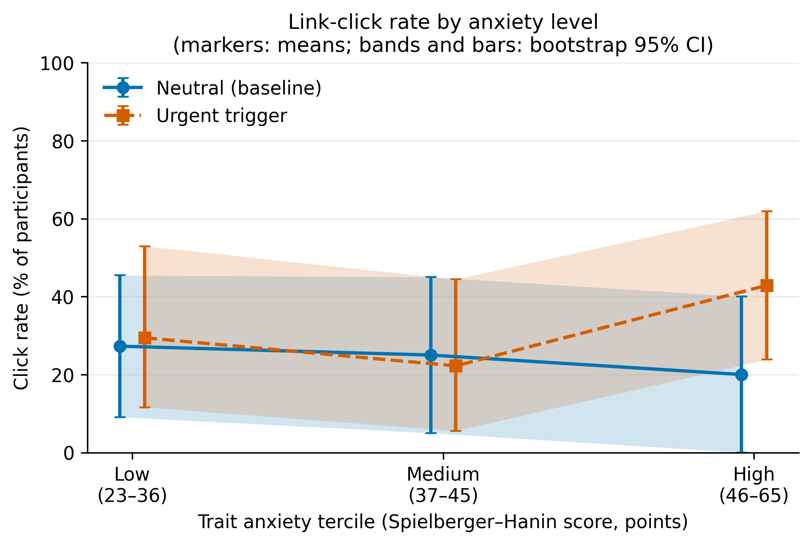
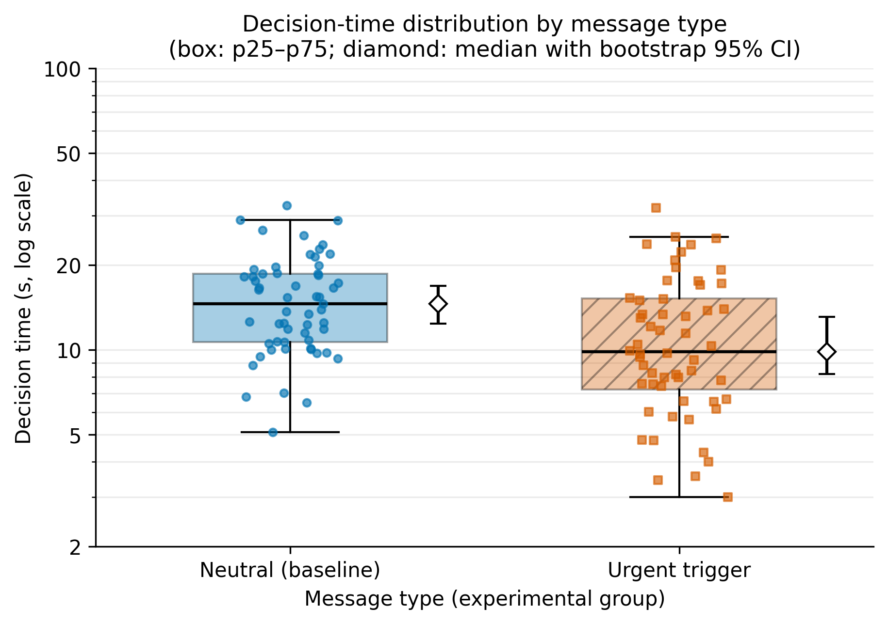

# Urgency Triggers and Phishing Susceptibility in Telegram: A Reproducible Experiment Pipeline

**Author:** Nazerke Kalibek ([@nazerkekalibek](https://github.com/nazerkekalibek)) · **Course:** Research Methods
**Status:** Task 3 — analysis pipeline, notebook, figures and domain model are complete and run end-to-end.

> ⚠️ **Data notice.** `data/raw/test_run.jsonl` is a **synthetic** log (every record carries `"source": "simulated"`).
> It validates the pipeline and is **not** a measurement of real participants. All numbers below describe the simulation.
> To analyze real data, replace that file with a file of the same schema and run `python src/main.py`.

## Research Question

> **RQ2.** How do high-intensity emotional triggers (threat of account blocking, urgency) affect decision time and the probability of clicking a phishing link in a Telegram-style message?

| | Statement |
|---|---|
| **H1a** (secondary) | Decision time is **shorter** under an urgency/fear trigger than under a neutral message. (H0a: not shorter.) |
| **H1b** (primary) | The probability of clicking the link is **higher** under an urgency/fear trigger than under a neutral message. (H0b: not higher.) |

Both tests are one-sided (matching the directional hypotheses) with a Bonferroni-adjusted α = 0.05 / 2 = 0.025. Full details: [`docs/methodology_card.md`](docs/methodology_card.md).

## Overview

Participants see screenshot-style mockups of Telegram messages (no real links). They are **randomly assigned** to one of two groups: *urgent* (high-intensity trigger, e.g., "your account will be blocked in 10 minutes") or *neutral* (informational text of the same length, the baseline). Every participant first sees one neutral **practice message (warm-up, discarded)** and then one **evaluation message** of their group. We record decision time and whether the participant would tap the link.

## Variables and Metrics

| Role | Variable |
|---|---|
| Independent (IV) | Message type: `urgent` vs. `neutral` |
| Dependent (DV) | Decision time (s); link click (0/1) |
| Controlled | Random assignment, mobile mockup, identical layout/sender/link pattern, same message length, warm-up trial, fixed seed |
| Covariate | Trait anxiety (Spielberger–Hanin, 20–80 points) |
| **Primary metric** | Click rate (bootstrap 95 % CI; one-sided Fisher exact) |
| Secondary metrics | Median decision time with p25–p75, p95, p99 (bootstrap 95 % CI; one-sided Mann–Whitney U) |
| Guardrails | Invalid-row (error) rate ≤ 10 % per group; time within [1, 120] s; group imbalance ≤ 30 %; ethics (mockups only, consent) |
| Baseline | Neutral-message group |

## Results & Discussion

*Synthetic data — pipeline validation only.* After the warm-up phase was discarded (120 rows) and guardrails applied, 113 of 120 evaluation rows were valid.

### Summary benchmark table (Baseline vs. Treatment)

| Metric | Baseline: neutral | Treatment: urgent |
|---|---|---|
| Valid participants (n) | 57 | 56 |
| Error-rate guardrail: invalid rows (%) | 5.0 | 6.7 |
| **Click rate, % (95 % CI)** — primary | 24.6 (14.0–36.8) | 32.1 (21.4–44.6) |
| **Decision time, s: median (p25–p75)** | 14.6 (10.6–18.6) | 9.8 (7.2–15.2) |
| Median 95 % bootstrap CI, s | 12.4–16.9 | 8.2–13.1 |
| Decision time p95, s | 27.1 | 24.0 |
| Decision time p99, s | 30.5 | 28.3 |
| Decision time, s: mean ± SD | 15.4 ± 6.1 | 11.8 ± 6.5 |

### Hypothesis tests (adjusted α = 0.025)

| Hypothesis | Test | Effect (95 % bootstrap CI) | p-value | Decision |
|---|---|---|---|---|
| **H1b** click rate higher | Fisher exact (greater) | risk difference = 7.6 pp (-8.5 to 23.6) | 0.247 | H0b not rejected |
| **H1a** time shorter | Mann-Whitney U (less) | median difference = -4.8 s (-7.8 to -0.6); Cliff's δ = -0.37 | 0.0003 | H0a rejected |

### Figures



*Figure 1. Link-click rate (%) by trait-anxiety tercile and message type. Markers: means; bands and bars: bootstrap 95 % CI.*



*Figure 2. Decision time (s, log scale) by message type. Box: p25–p75; diamond: median with bootstrap 95 % CI. Vector versions (`.pdf`) are in the same folder.*

### Discussion

- **Pipeline check:** on the simulated file the pipeline recovers the built-in difference in decision time (H1a) and shows a click-rate difference whose interval includes 0 (H1b). This demonstrates the analysis works; it says nothing about real users, because the effects were set by the data generator.
- **Why intervals are wide:** about 57 participants per group (and ~19 per anxiety stratum) give limited power, especially for a binary outcome; the figures show this uncertainty rather than hiding it.
- **Limitations:** mockup clicking measures intention, not real behavior; one evaluation message per participant; p99 from ~55 observations is a rough tail estimate.

## Domain Model (STRIDE)

A STRIDE threat matrix for the phishing scenario in a messenger (Scope A) and for the research instrument itself (Scope B), with a data-flow diagram and links to the hypotheses, is in [`docs/domain_model.md`](docs/domain_model.md).

## Quickstart Guide

**Option A: Docker (2 commands)**

```bash
docker build -t phishing-trigger-experiment .
docker run --rm phishing-trigger-experiment
```

**Option B: local Python (3 steps)**

```bash
python -m venv .venv                      # Windows: py -m venv .venv
source .venv/bin/activate                 # Windows PowerShell: .venv\Scripts\Activate.ps1
pip install -r requirements.txt && python src/main.py --config configs/config.yaml
```

The pipeline reads `data/raw/test_run.jsonl`, writes `data/processed/` (`clean_trials.csv`, `metrics_summary.csv`, `tests_summary.json`) and `reports/figures/` (PDF + 300 DPI PNG).

To re-run the notebook: `pip install -r requirements-notebook.txt`, open `notebooks/01_data_analysis.ipynb`, then *Kernel → Restart & Run All*.
To regenerate the synthetic file: `python src/simulate_data.py` (overwrites `data/raw/test_run.jsonl`).

## System Requirements

- Python 3.12 (reference environment: Docker image `python:3.12.3-slim`)
- Libraries pinned in `requirements.txt` (numpy 2.4.4, pandas 3.0.2, scipy 1.17.1, PyYAML 6.0.3, matplotlib 3.10.8, seaborn 0.13.2)

## Repository Structure

```
phishing-trigger-experiment/
├── README.md
├── LICENSE
├── Dockerfile
├── requirements.txt              # exact version pins
├── requirements-notebook.txt     # optional: only to open the notebook
├── .gitignore
├── configs/
│   └── config.yaml               # all experiment parameters
├── data/
│   ├── raw/test_run.jsonl        # raw log (warm-up + evaluation rows; SIMULATED)
│   └── processed/                # clean trials, metrics_summary.csv, tests_summary.json
├── docs/
│   ├── methodology_card.md
│   └── domain_model.md           # STRIDE threat model
├── notebooks/
│   └── 01_data_analysis.ipynb    # executed, outputs preserved
├── reports/figures/              # fig1 / fig2 as .pdf and .png (300 DPI)
└── src/
    ├── main.py                   # entry point
    ├── process_data.py           # warm-up filter, guardrails, statistics
    ├── visualize.py              # publication figures
    └── simulate_data.py          # synthetic data generator (pipeline validation)
```

## Ethics

Only static mockups are shown; no real phishing links are used and no credentials are collected. Participants give informed consent, may stop at any time, and are debriefed that all messages were part of a training exercise. Real participant data must never be committed to this repository.

## Citation / License

Released under the [MIT License](LICENSE). Please cite:

```
Kalibek, N. (2026). Urgency Triggers and Phishing Susceptibility in Telegram:
A Reproducible Experiment Pipeline. GitHub repository.
https://github.com/nazerkekalibek/phishing-trigger-experiment
```
