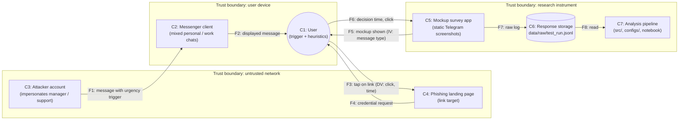

# Domain Model — STRIDE Threat Model

**Track:** Cybersecurity · **Method:** STRIDE (Spoofing, Tampering, Repudiation, Information disclosure, Denial of service, Elevation of privilege)

The model has two scopes, because the project contains two systems:

- **Scope A — the studied system:** a phishing attack against a user inside a messenger (Telegram). This is the *object of research*: each threat is linked to the cognitive trigger or variable that the experiment manipulates.
- **Scope B — the research instrument:** the experiment and analysis pipeline itself. These threats could invalidate the study's conclusions or harm participants.

## 1. System components and data flows

*Measurement points of the experiment:* **F5** (independent variable is applied), **F6** (dependent variables are recorded), **F7** (raw log is written).

| ID | Component | Role in the study |
|---|---|---|
| C1 | User | The subject; the cognitive trigger (fear, urgency) acts here |
| C2 | Messenger client | UX context (mixed personal/work chats, mobile screen) |
| C3 | Attacker account | Source of the manipulative message |
| C4 | Phishing landing page | Target of the click (not built; mockups only) |
| C5 | Mockup survey app | Presents messages, records time and click |
| C6 | Response storage | `data/raw/test_run.jsonl` |
| C7 | Analysis pipeline | `src/process_data.py`, `src/visualize.py`, notebook |

## 2. STRIDE threat matrix

### Scope A — phishing attack in a messenger

| # | Component / flow | STRIDE | Threat | Link to the research | Control / mitigation |
|---|---|---|---|---|---|
| A1 | C3 → C2 (F1) | **S**poofing | Attacker impersonates a manager, colleague or "Telegram Support" using a look-alike name/avatar | Authority heuristic; in mixed personal/work chats the sender is checked less (RQ1) | Verified-sender badges; show full username/ID; out-of-band confirmation for requests |
| A2 | C3 → C2 (F1) | **T**ampering | Link text shows a trusted domain while the real URL differs (masked link); lookalike domain in the preview | Mobile screens truncate metadata, so the indicator is not visible (RQ1) | Show the real URL before opening; warn on mismatch between link text and target |
| A3 | C3 / C1 | **R**epudiation | Sender deletes the message or account after the attack; the victim cannot prove what was received | Increases attacker impunity; victims are reluctant to report | Local message export/screenshots; central logging of reported incidents |
| A4 | C4 → C1 (F4) | **I**nformation disclosure | Fake login or "account verification" page harvests credentials, phone number, one-time codes | Fear of account loss pushes the user to comply (H1b: click) | Hardware keys / passkeys; never enter codes on pages reached via messages |
| A5 | C3 → C1 (F1) | **D**enial of service | Fake "your account will be blocked in 10 minutes" threat as a pressure tool; message flooding that creates urgency and fatigue | Urgency trigger shortens decision time (H1a) | Staged cool-off: "wait before acting" prompts; official status pages for account issues |
| A6 | C1 → C2 | **E**levation of privilege | A compromised personal account gives access to work chats, files and contacts of the same user | Mixed personal/work context turns one click into broad access (RQ1) | Separate work and personal profiles; MFA; least-privilege access to work chats |

### Scope B — the research instrument

| # | Component / flow | STRIDE | Threat | Impact on validity or participants | Control / mitigation |
|---|---|---|---|---|---|
| B1 | C5 (F5) | **S**poofing | Same person participates twice or under another identity, entering both groups | Breaks independence and random assignment | One-time participant IDs; one attempt per ID |
| B2 | C6 / C7 (F7, F8) | **T**ampering | Raw log edited after collection (rows deleted or values changed) | Results no longer reflect what participants did | Keep raw file read-only; commit hash of the raw log; processing never writes to `data/raw/` |
| B3 | C5 / C7 | **R**epudiation | No record of which exclusions or config were used for a result | Analysis cannot be audited or reproduced | `configs/config.yaml` and fixed seed in Git; guardrail report written on every run |
| B4 | C6 | **I**nformation disclosure | Anxiety scores or participant IDs leak through the public repository | Privacy violation | Only anonymized IDs; real raw data stays out of Git (`.gitignore`); informed consent states data use |
| B5 | C5 | **D**enial of service | Survey app fails or times out; rows with `app_error` / `timeout` | Missing data; biased exclusions | Error-rate guardrail per group (limit 10%); invalid rows reported, not silently dropped |
| B6 | C7 | **E**levation of privilege | Credentials or tokens committed to the repository give outside access to data or accounts | Data and account compromise | No secrets in code; `.env`, `*.key`, `*.pem` ignored; Docker image holds no secrets |

## 3. How the model ties to the hypotheses

| Hypothesis | Threats it operationalizes |
|---|---|
| **H1a** — decision time is shorter under an urgency trigger | A5 (urgency / account-block pretext), A1 (authority) |
| **H1b** — click probability is higher under an urgency trigger | A4 (credential harvesting via click), A2 (masked links) |
| **RQ1** (future work) — mixed personal/work context reduces recognition of indicators | A1, A2, A6 |

## 4. Residual risks and limits

- The experiment uses static mockups only: no real phishing links, pages or credentials (this removes A4's real harm for participants).
- STRIDE here is qualitative: threats are not scored by likelihood or impact.
- Scope A threats are described at the level needed to define experimental conditions; no operational attack instructions are given.
